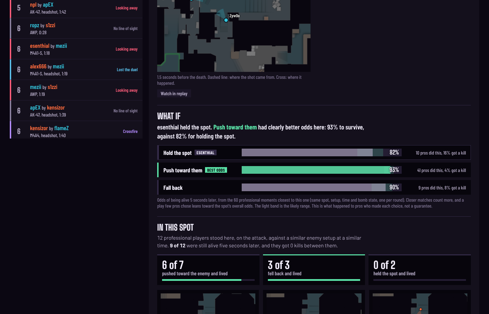
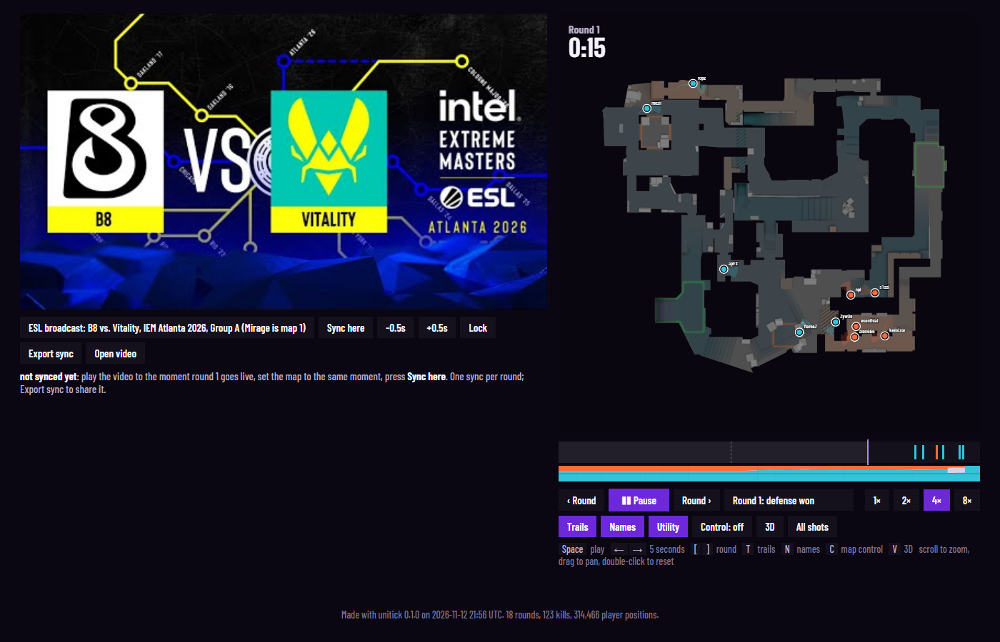
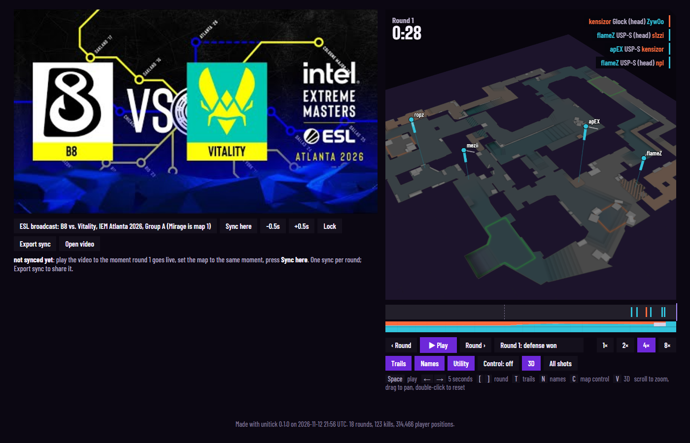

<p align="center">
  <strong>unitick: see why you died in your last FPS match, and your odds of surviving with every other play.</strong>
</p>

<p align="center">
  Reads your VALORANT, CS2 or Siege X replay offline and explains every death.
  In CS2 it also scores every play you could have made (hold, push, fall back) against how pros survived that exact moment,
  with a 2D/3D replay synced to your video. Open source.
</p>

<br />

<p align="center">
  <a href="https://github.com/ZeonGames/unitick">Repository</a> •
  <a href="https://gamesbyzeon.com">Website</a> •
  <a href="https://discord.gg/UwWRqgREXj">Discord</a> •
  <a href="https://chat.whatsapp.com/HaAV7ahK8ItCtJmM2CN5p6">WhatsApp</a> •
  <a href="https://www.linkedin.com/company/zeonai/">LinkedIn</a> •
  <a href="https://www.youtube.com/@zeongamesandstudio">YouTube</a> •
  <a href="https://x.com/ZeonGamesStudio">Twitter</a> •
  <a href="https://www.instagram.com/gamesbyzeon/">Instagram</a>
</p>

<p align="center">
  <a href="https://github.com/ZeonGames/unitick/actions/workflows/ci.yml"></a>
  
  
  <a href="LICENSE"></a>
</p>

---

## See it

From the bundled Vitality vs B8 sample (IEM Atlanta 2026). Click a still to open the short clip. Run `unitick app` and open the same match to drive it yourself.

<table>
  <tr>
    <td align="center" width="50%">
      <b>Deaths</b> - why each player died, and their odds with every other play<br />
      <a href="docs/readme/feature-deaths.webm"></a>
    </td>
    <td align="center" width="50%">
      <b>Replay</b> - hit Play on the 2D radar, then flip to 3D and orbit<br />
      <a href="docs/readme/feature-replay.webm"></a>
    </td>
  </tr>
  <tr>
    <td align="center" width="50%">
      <b>2D play</b><br />
      <a href="docs/readme/feature-replay.webm"></a>
    </td>
    <td align="center" width="50%">
      <b>3D orbit</b> - press <code>V</code>, drag to rotate<br />
      <a href="docs/readme/feature-replay.webm"></a>
    </td>
  </tr>
</table>

<p align="center">
  Full ESL broadcast for that map:
  <a href="https://www.youtube.com/watch?v=1bUFCQf0l28">B8 vs Vitality on YouTube</a>
  (in the app, open <code>http://localhost:8765</code> so the embed can play beside the radar).
</p>

---

## Quick start

unitick never touches a running game. It only reads finished replays (`.dem`, `.vrf`, `.rec`), so it stays safe next to Vanguard, VAC and BattlEye. The local app and report server bind to this machine only (`127.0.0.1`); nothing is uploaded.

**Windows (players):**

1. Download the zip, right-click → **Extract All**, open the folder.
2. Double-click **`START_HERE.bat`**. First run installs Python if needed, then shows a menu:
   - `1` the unitick app in your browser: every match on this PC, drop in new replays
   - `2` watch mode: leave open while you play; each new match gets a report
   - `3` analyze replays already on this PC
   - `4` analyze one file (drag a `.dem` / `.vrf` / R6 folder)
   - `5` sample reports: real VALORANT, CS2 and R6 matches, no game needed

Reports land in `%USERPROFILE%\unitick\reports`. Failures write `setup_log.txt`; attach that to an issue.

Or drag a replay onto `report.bat` after the first setup.

**Install / CLI (developers):** always use a local `.venv`. Installing into the system/user Python often puts `unitick` somewhere that is not on PATH (especially on Windows).

Windows (PowerShell), from the repo root:

```powershell
python -m venv .venv
.\.venv\Scripts\Activate.ps1
# If activate is blocked: Set-ExecutionPolicy -Scope CurrentUser RemoteSigned
pip install -e ".[cs2]"
unitick report match.dem            # or .vrf, or an R6 match folder → one .html
unitick watch --open                # auto-analyze new replays after you play
unitick samples                     # build reports for every bundled sample
```

macOS / Linux:

```bash
python3 -m venv .venv
source .venv/bin/activate
pip install -e ".[cs2]"
unitick report match.dem
unitick watch --open
unitick samples
```

If `unitick` is still not recognized, use `python -m unitick ...` with the venv active (or `.venv\Scripts\python.exe -m unitick ...` / `.venv/bin/python -m unitick ...` without activate). Full setup, tests, and the web app: [CONTRIBUTING.md](CONTRIBUTING.md).

---

## Web app

Browse every match on your PC, open full reports and analyze new replays from a local site. Nothing leaves your machine. Needs Python 3.11+ and Node 18+.

Windows (PowerShell), from the repo root:

```powershell
python -m venv .venv
.\.venv\Scripts\Activate.ps1
# If activate is blocked: Set-ExecutionPolicy -Scope CurrentUser RemoteSigned
pip install -e ".[all]"             # VALORANT, CS2, Siege X, tests
cd web; npm install; npm run build; cd ..
unitick app                         # opens http://localhost:8765
```

macOS / Linux:

```bash
python3 -m venv .venv
source .venv/bin/activate
pip install -e ".[all]"
cd web && npm install && npm run build && cd ..
unitick app
```

Working on the UI? Keep the venv active, then run the API and the Vite dev server side by side:

```bash
unitick app --no-browser            # API on :8765
cd web && npm run dev               # http://localhost:5173 with hot reload
```

The app lists the bundled samples, matches from watch mode (`~/unitick/matches`) and your uploads. Drop a `.dem`, a `.vrf` or every `.rec` of one Siege match on **Analyze a replay**; the report opens when it is ready. VALORANT and Siege X parsers ship in `tools/`, so `[all]` is the only install you need. If `unitick` is not found, run `python -m unitick app` instead.

---

## Try it without a replay

`samples/` ships real matches only: six full VALORANT matches (one Competitive, five Swiftplay), ten CS2 matches including Vitality vs B8 (IEM Atlanta 2026, ESL broadcast linked) and 9z vs PARIVISION (XSE 2026 final), and 12 Siege rounds including Liquid vs Magic Squad. Map images and CS2 line-of-sight meshes are bundled, so everything works offline.

```bash
unitick samples
unitick serve ~/unitick/reports/samples    # needed for YouTube embeds
```

See [samples/README.md](samples/README.md).

---

## Features

- **Deaths tab**: cause of every death (looking away, crossfire, never fired, lost the duel, no LOS), then the closest moments from a pro library and how often those players lived
- **What if**: at every death, your odds of surviving if you had held, pushed or fallen back, from the most similar pro moments, with how many players each number rests on and a likely range. Checked on held-out pro matches ([method](docs/whatif.md))
- **CrosshairIQ**: placement scored at the tick each enemy came into line of sight (real mesh ray-cast on CS2)
- **Map control**: reach and vision learned from replay positions; smokes block sight, fires block movement
- **Executes + playbook**: site hits clustered into SVG sketches, order-free so the same play still groups
- **2D + 3D replay**: radar with trails, cones, utility, tracers; press `V` for WebGL heights and bullet beams
- **Video sync**: NVIDIA / OBS by file time, or YouTube broadcasts synced per round
- **Watch mode**: new replay drops in, report opens
- **One schema for every game**: seven canonical tables; analytics never special-case a title
- **Offline HTML**: single self-contained report, no CDN
- **Safe by design**: replay files only, never memory or live screen capture

---

## Supported games

| Game | Replay | Parser | What you get |
| --- | --- | --- | --- |
| **CS2** | `.dem` | awpy 3 | full stack, including LOS crosshair scoring |
| **VALORANT** | `.vrf` in `%LOCALAPPDATA%\VALORANT\Saved\Demos` | vrfkit (bundled in `tools/`) | 128 Hz positions/aim, kills, spike, abilities, replay, executes |
| **Siege X** | `.rec` under MatchReplay | r6-dissect (bundled) | kill feed, plants/defuses, scoreboard, openings, trades (no positions in the format) |
| anything else | CSV / Parquet / JSON | table adapter | whatever columns you map |

---

## The report

One HTML file, five tabs:

| Tab | What it shows |
| --- | --- |
| **Overview** | Round results + scoreboard (K/D/A, ADR, KAST, HS%, openings, trades) |
| **Deaths** | Cause of each death, your odds with every other play (what if), similar pro situations |
| **CrosshairIQ** | Placement score when each enemy entered sight |
| **Executes** | Site hits per round + clustered playbook sketches |
| **Replay** | 2D radar + video. `C` = map control, `V` = 3D |

### Video

```bash
unitick report match.vrf --find-video          # pair NVIDIA / OBS by file time
unitick report match.dem --video clip.mp4
unitick report match_dir --youtube <id or url>
unitick serve                                  # http://localhost, needed for YouTube
```

Watch mode pairs recordings automatically. Short clips land at the right moment on the timeline.

---

## Why unitick

Built on [awpy](https://github.com/pnxenopoulos/awpy) for CS2, then the same coaching layer for every game that saves replays:

| | awpy 3 | unitick |
| --- | --- | --- |
| Games | CS2 | CS2, VALORANT, Siege X, any table export |
| Map control | Valve nav / collision meshes | learned from positions (works without map files) |
| Per-death analysis | build it yourself | cause + LOS / facing / crossfire / trade |
| “What should I have done?” | no | survival odds for hold, push and fall back at every death, from 82 pro demos |
| Output | DataFrames / plots | same tables + offline HTML synced to video |

Checked against independent sources (awpy / r6-dissect on the bundled samples). A 30-round demo parses in ~10s; full report ~1s more.

---

## Python

```python
from unitick.adapters import cs2
from unitick.analytics import autopsy, control, crosshair, executes, fights, situations
from unitick.render import report

m = cs2.load("match.dem")
vis = cs2.visibility(m.map_name)

crosshair.leaderboard(crosshair.placement(m, visibility=vis))
fights.scoreboard(m)
executes.playbook(m)
deaths = autopsy.autopsy(m, visibility=vis)

lib = situations.default_library()
lib.search(map_name="de_mirage", side="defense", pos=(-300, -1200),
           enemies=[(-600, -1500)], mates=[], t_live=40, planted=False, pro_only=True)

grid, _ = control.grid_for(m, lib)
report.render(m, "match.html", visibility=vis)
```

---

## Canonical schema

Every adapter writes the same seven tables. Analytics and the UI only see these.

| Table | One row per | Key columns |
| --- | --- | --- |
| `rounds` | round | `round_num, start_tick, live_tick, end_tick, winner_side, reason` |
| `frames` | player × tick | `tick, player_id, side, x, y, z, pitch, yaw, health, is_alive, is_crouched` |
| `kills` | kill | `attacker_*, victim_*, assister_*, weapon, headshot` |
| `damages` | hit | `attacker_*, victim_*, weapon, damage, hitgroup` |
| `shots` | fire | `player_id, x, y, z, pitch, yaw, weapon` |
| `utility` | nade / ability | `start_tick, end_tick, kind, x, y, z, origin_*` |
| `objectives` | plant / defuse | `event, site`, position |

`side` is always `attack` or `defense`. `yaw` is degrees CCW from +x; `pitch` positive looking down. Ids are strings. `Match.save(dir)` writes zstd parquet + `meta.json`.

### Other games (table adapter)

```json
{
  "game": "valorant", "map_name": "Ascent", "tick_rate": 128, "time_unit": "ms",
  "sides": {"Attacker": "attack", "Defender": "defense"},
  "tables": {
    "frames": {"path": "positions.csv", "columns": {"time_ms": "tick", "puuid": "player_id", "team": "side"}},
    "kills":  {"path": "kills.csv", "columns": {"time_ms": "tick", "killer": "attacker_id", "victim": "victim_id"}}
  }
}
```

```bash
unitick report valorant_spec.json
```

---

## CLI

```
unitick parse     match.dem -o match_dir/
unitick report    match.dem [-o out.html] [--mesh ...] [--radar ...] [--find-video] [--youtube ...]
unitick crosshair match.dem [--csv fights.csv]
unitick stats     match.dem
unitick deaths    match.dem [--player NAME] [--csv deaths.csv]
unitick executes  match.dem --svg-dir sketches/
unitick library   my_matches/*.dem
unitick watch     [--open] [--new-only] [--once] [--game valorant cs2 r6]
unitick samples   [--raw] [--open]
unitick serve     [reports_dir]
unitick app       [--port 8765] [--no-browser]
```

---

## Project layout

```
src/unitick/
  adapters/      cs2, valorant, r6, table, synthetic
  analytics/     autopsy, situations, whatif, control, crosshair, fights, executes
  render/        report payload + report.js renderer (single-file HTML and web app)
  schema.py      seven canonical tables
  match.py       build / save / load / anonymize
  cli.py         unitick command
  watch.py       folder watcher
  app.py         local web app API
samples/         real matches + pro situation library
docs/            what-if method (whatif.md), feature clips and stills used above
scripts/         validate_whatif.py: checks the what-if on held-out pro matches
web/             React + TypeScript UI (Vite)
tools/           bundled vrfkit + r6-dissect (see SOURCES.txt)
tests/           pytest, including parser cross-checks
```

---

## Development

Use a `.venv` (see [CONTRIBUTING.md](CONTRIBUTING.md)). With it activated:

```bash
pip install -e ".[all]"
pytest
UNITICK_DEMO=path/to/match.dem pytest    # also cross-check against awpy
ruff check src tests scripts
python scripts/validate_whatif.py       # what-if calibration on held-out pro matches
cd web && npm run typecheck && npm run build
```

---

## Credits

Thank you to Peter Xenopoulos and the awpy contributors: awpy 3 is the foundation of everything unitick does in CS2.

- CS2: [awpy](https://github.com/pnxenopoulos/awpy) + awpy-data (MIT), on [demoparser2](https://github.com/LaihoE/demoparser) by LaihoE
- VALORANT: [vrfkit](https://github.com/wbxs2077/vrfkit) by wbxs2077 (MIT), with patches ported from [ValorantReplayParser](https://github.com/michel-giehl/ValorantReplayParser) by Michel Giehl (MIT)
- R6: [r6-dissect](https://github.com/redraskal/r6-dissect) by redraskal (MIT)
- Map / agent metadata: valorant-api.com
- Exact tool commits: `tools/SOURCES.txt`

---

## Contributing

New game adapters and scoreboard cross-checks are especially welcome. See [CONTRIBUTING.md](CONTRIBUTING.md).

- Issues: https://github.com/ZeonGames/unitick/issues
- Security: email hi@gamesbyzeon.com (do not open a public issue)
- Chat: [Discord](https://discord.gg/UwWRqgREXj), [WhatsApp](https://chat.whatsapp.com/HaAV7ahK8ItCtJmM2CN5p6)

---

## About Zeon

Zeon builds AI that learns from games, gestures, and human behaviour in motion. unitick turns finished matches into structured coaching signal (positions, aim, decisions), the same kind of ground truth those systems need.

**More:** [gamesbyzeon.com](https://gamesbyzeon.com), [LinkedIn](https://www.linkedin.com/company/zeonai/), [YouTube](https://www.youtube.com/@zeongamesandstudio), [Twitter](https://x.com/ZeonGamesStudio), [Instagram](https://www.instagram.com/gamesbyzeon/)

---

<p align="center">
  <strong>Built by <a href="https://gamesbyzeon.com">Zeon Games &amp; Studio</a></strong>
</p>

unitick is MIT ([LICENSE](LICENSE)). Bundled parsers keep their own MIT licenses under `tools/`. Embedded fonts are SIL OFL.
